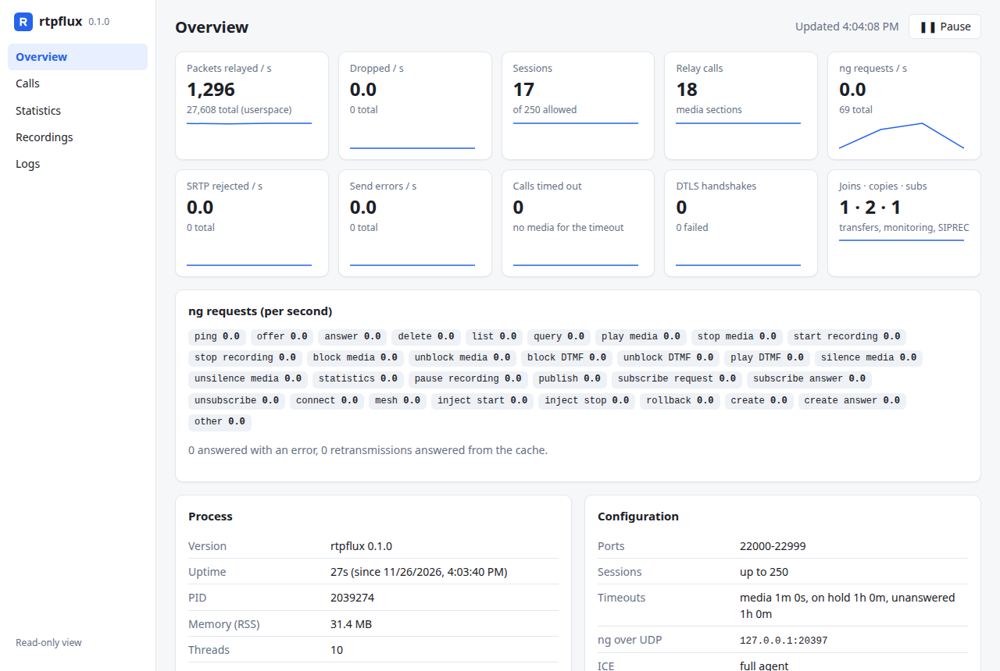
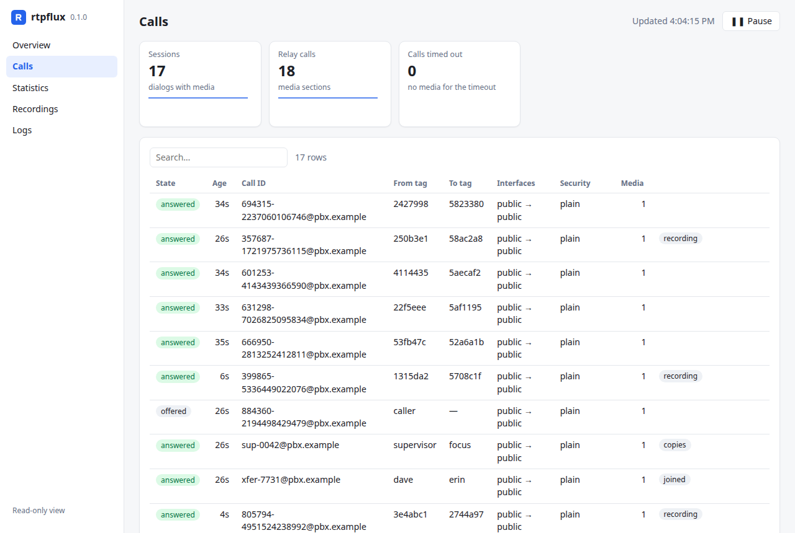
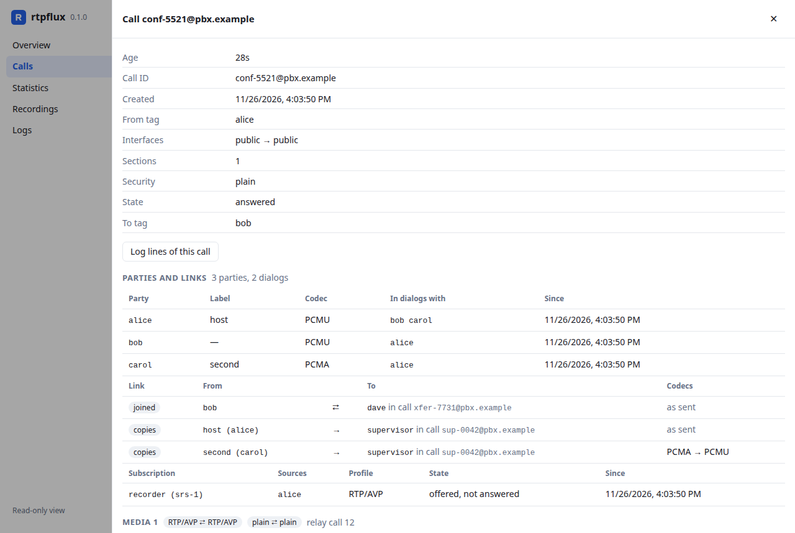
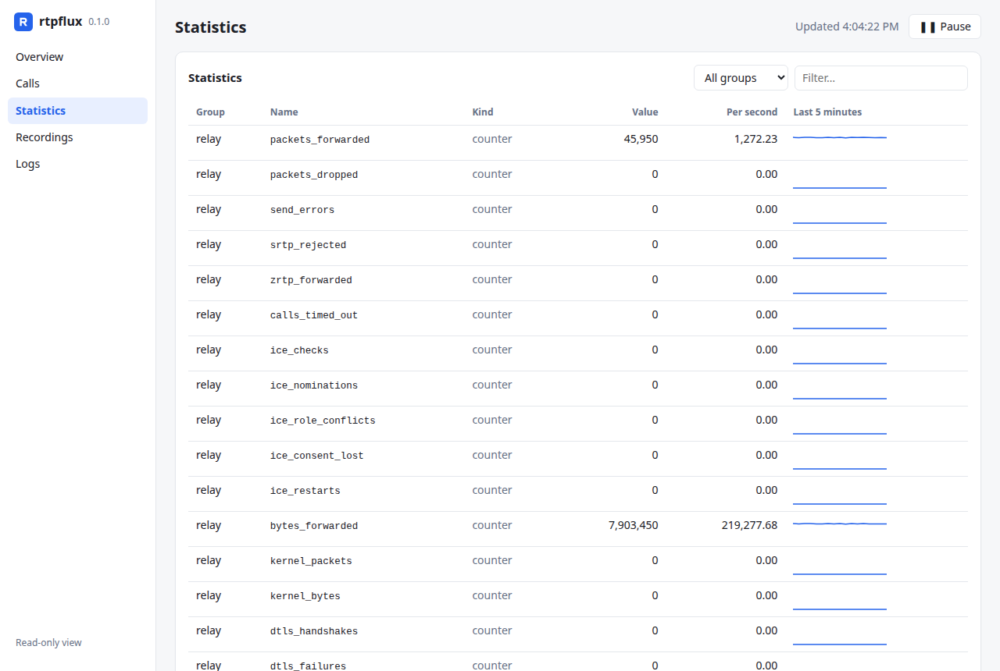
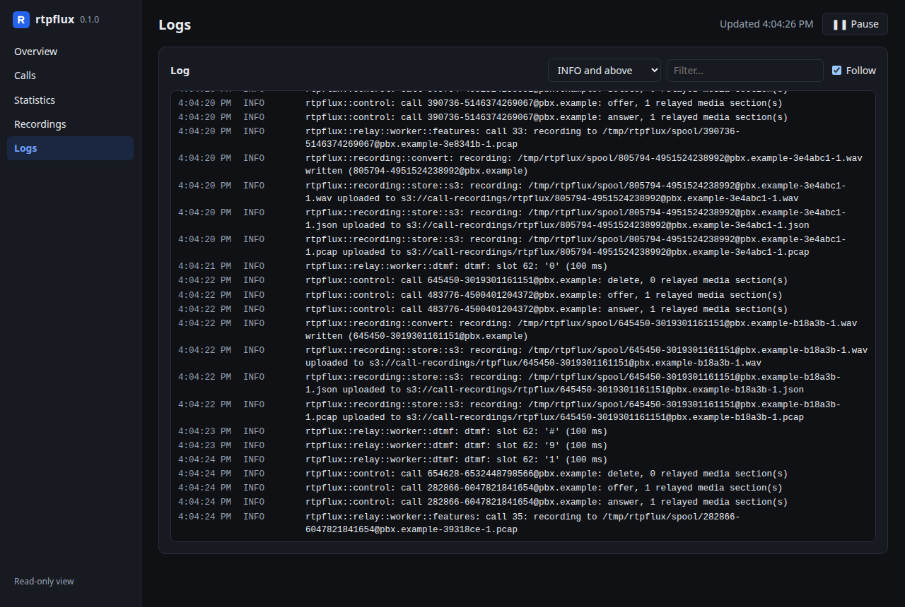
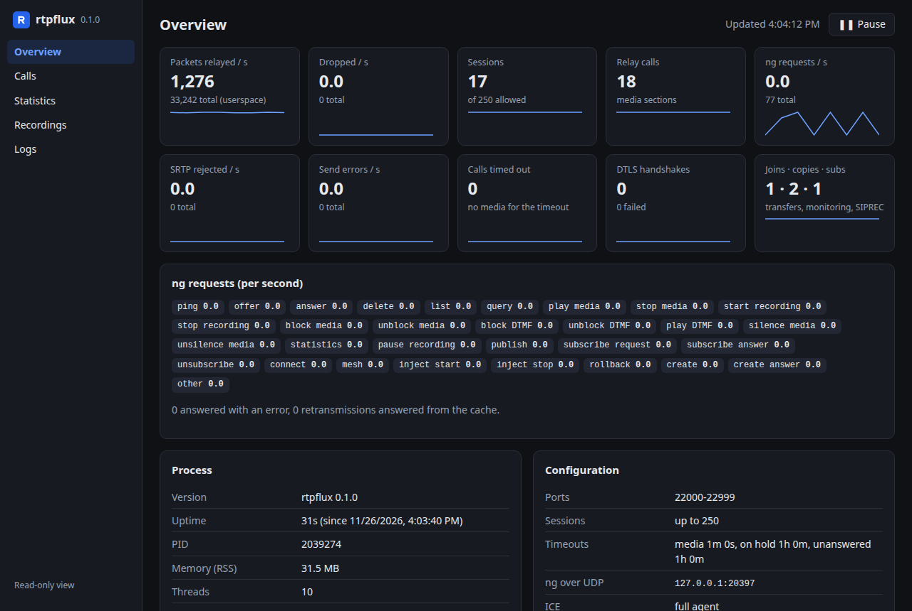
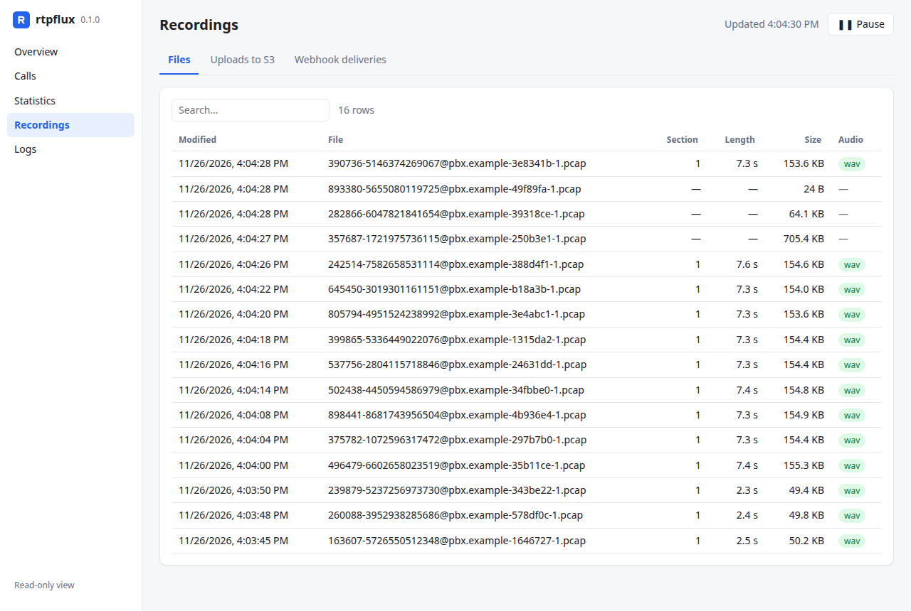
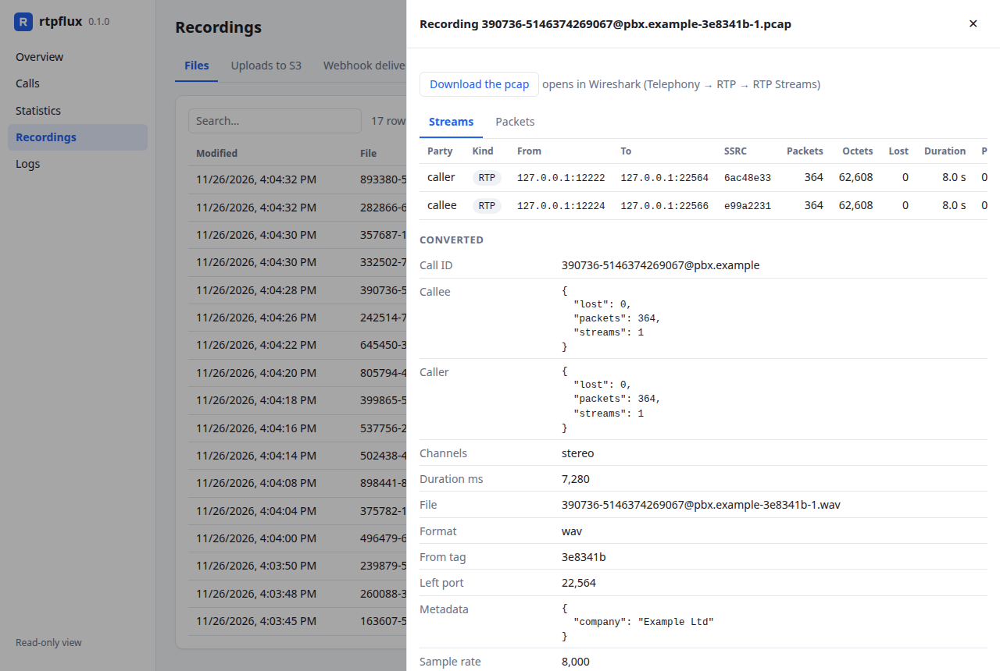
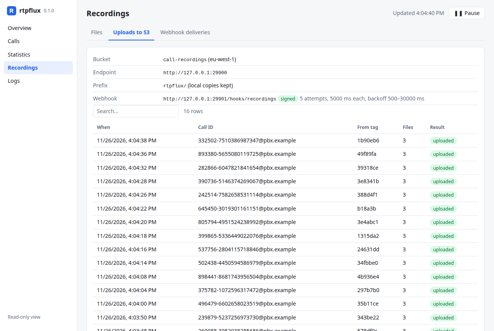
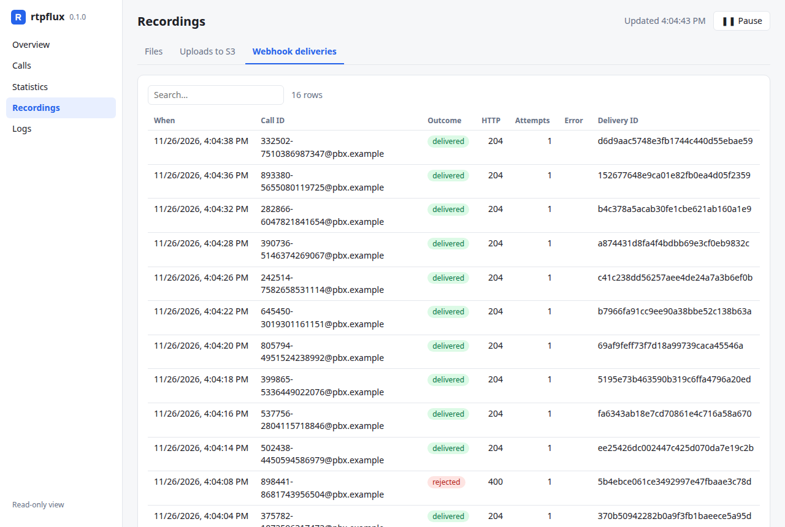

# rtpflux

[](https://github.com/RustedBytes/rtpflux/actions/workflows/ci.yml)

**A fast media relay for SIP voice and video calls, written in Rust.**

rtpflux sits between the phones (or browsers) in a call and forwards their
audio and video. A SIP proxy such as [Kamailio](https://www.kamailio.org/)
or [OpenSIPS](https://opensips.org/) tells it about each call over the
**ng protocol**, the same control protocol their `rtpengine` modules
already speak. So rtpflux can take the place of
[rtpengine](https://github.com/sipwise/rtpengine) without changing how the
proxy is set up.

## What it does

- **Relays RTP and RTCP** between the two sides of a call, including
  callers behind NAT. It learns where media really comes from
  ("latching").
- **Bridges WebRTC and SIP phones.** It speaks ICE (a full agent with
  consent freshness and trickled candidates, or ICE-lite), DTLS-SRTP,
  `rtcp-mux` and BUNDLE towards browsers, and plain RTP or SDES-SRTP towards
  phones.
- **Encrypts and decrypts SRTP** on either side. It supports AES-CM (128- and
  256-bit) with HMAC-SHA1, and AES-GCM.
- **Transcodes audio** between PCMU, PCMA (G.711), G.722, G.729 and Opus
  (and AMR / AMR-WB with the `amr` build feature), and relays T.38 fax.
  rtpengine's codec options choose what each side is offered (`transcode`,
  `mask`, `strip`, `except`, `offer`) and the packet time (`ptime`, with
  repacketisation), and its `SDES`, `DTLS` and
  `rtcp-mux` options shape the encryption and RTCP of each side. An option
  it does not implement is named in the reply's `warning`, not silently
  dropped.
- **Call features:** DTMF detection and injection (`play DTMF`, as RFC
  4733 events or in-band tones), muting a participant (block media or
  only DTMF, or silence it while the stream goes on), call recording to WAV, FLAC, Ogg Opus or MP3 (stereo or
  mono, the rate and bitrate you choose; kept locally or uploaded to an
  S3 bucket, with an optional signed webhook after each upload), playing
  announcements, and
  per-stream statistics including packet loss, jitter and round-trip time.
- **Handles re-INVITEs** from either party, hold and resume, and adding or
  removing streams; forked INVITEs, and calls with more than two parties
  (a party in dialogs with several others, labels to address them).
- **A media engine for a B2BUA or softswitch:**
  - the ng commands `create` and `create from offer`, and a
    [native control API](docs/native-api.md) on a Unix socket;
  - endpoints negotiated either way, parked, bridged across calls,
    renegotiated with commit or abort, destroyed with tombstones;
  - generations, idempotency keys, leases and tenants;
  - events: DTMF, announcements, recordings, ICE, DTLS, speech, bridges;
  - PCM streams to external audio services (speech recognition, voice
    bots), with barge-in and playout marks;
  - N − 1 conference mixing with active-speaker events, and recording
    of the conference's mix;
  - echo (an endpoint hears itself), for echo tests.

  A Rust client is in `crates/rtpflux-client`. See
  [Media engine](docs/media-engine.md) for its status.
- **Keeps calls across restarts** when a state file or Redis is
  configured; with Redis, another host can take them over.
- **Optional kernel fast path.** Settled RTP calls can be forwarded in the
  network driver with XDP, without passing through userspace, including
  calls with DTMF detection, blocking, announcements or recording.
  Encrypted and WebRTC calls can be received through AF_XDP sockets.
- **Operations:** a read-only web UI with live traffic, calls, recordings (a pcap viewer) and logs,
  Prometheus metrics, structured logs, and a hardened systemd unit.

## Web UI

An optional, read-only website shows what the relay is doing right now.
Turn it on with a `[webui]` section; see [Web UI](docs/webui.md).

| | |
|---|---|
| [](docs/images/webui-overview.png) | [](docs/images/webui-calls.png) |
| **Overview.** Packets relayed and dropped, sessions, ng requests, DTLS handshakes, transfers, copies and subscriptions, each with a five-minute history; the process, how each media worker receives, and the configuration, with warnings from start-up. | **Calls.** Every dialog with its state, age, tags, interfaces and security, and badges for what is on (recording, blocked, an announcement) and what links it to other calls (multi-party, joined, copies, subscribed). Search, sort and pages. |
| [](docs/images/webui-call.png) | [](docs/images/webui-statistics.png) |
| **A call.** Its parties, labels and codecs, the transfers and copies that link it to other calls (with codec conversion), and its subscriptions; then each media section's negotiation and, per leg, the peer, counters, loss, jitter, round-trip time, DTMF, latching, DTLS and ICE state. | **Statistics.** Every counter and gauge from `/metrics`, with its rate per second and recent history. |
| [](docs/images/webui-logs.png) | [](docs/images/webui-overview-dark.png) |
| **Logs.** A live tail of recent log lines, with a level filter and search; a call's page opens it on that call. | **Dark mode.** Light and dark follow the system; the layout also works on a phone. |
| [](docs/images/webui-recordings.png) | [](docs/images/webui-recording.png) |
| **Recordings.** The pcaps in the recording directory, with their length, size and audio file. Search, sort and pages. | **A recording.** Its streams (packets, octets, loss, length), the converter's report, and every packet's RTP or RTCP header, with a download for Wireshark. |
| [](docs/images/webui-uploads.png) | [](docs/images/webui-webhooks.png) |
| **Uploads to S3.** With `storage = "s3"`: the bucket, endpoint and webhook, then each recording's upload. | **Webhook deliveries.** Each upload notification: delivered, retried, rejected or dropped, with its HTTP status, attempts and delivery id. |

## How it fits in

```text
        SIP signalling                         SIP signalling
 Alice ───────────────►  SIP proxy (Kamailio) ◄─────────────── Bob
   │                         │  ng commands over UDP
   │                         ▼  (offer / answer / delete …)
   │   RTP/SRTP          ┌─────────┐          RTP/SRTP           │
   └────────────────────►│ rtpflux │◄────────────────────────────┘
                         └─────────┘
```

1. Alice's INVITE reaches the proxy. The proxy sends the SDP offer to
   rtpflux.
2. rtpflux reserves ports and rewrites the SDP so that media goes to
   rtpflux, not straight to Alice. The proxy forwards the rewritten offer
   to Bob.
3. Bob's answer goes through rtpflux the same way.
4. Both phones now send media to rtpflux, which forwards it to the other
   side. It also translates encryption and codecs when needed.

## Quick start

You need Rust; the toolchain version is pinned in `rust-toolchain.toml`.
rtpflux is pure Rust, so no C libraries or C compiler are needed. (Two
optional features build C code: `mp3`, for MP3 recordings, and `s3`, for
recordings in S3: `cargo build --release --features mp3,s3`.)

```sh
git clone https://github.com/RustedBytes/rtpflux.git
cd rtpflux
cargo build --release
```

Write a minimal configuration. Only the media interface is required:

```toml
# rtpflux.toml
[control]
listen = ["127.0.0.1:2223"]   # where the SIP proxy sends ng commands

[[interface]]
name = "default"
address = "203.0.113.10"      # the address phones send media to
```

Check it and start the relay:

```sh
./target/release/rtpflux --check -c rtpflux.toml
./target/release/rtpflux -c rtpflux.toml
```

Then point Kamailio's `rtpengine` module at it:

```text
loadmodule "rtpengine.so"
modparam("rtpengine", "rtpengine_sock", "udp:127.0.0.1:2223")

route[MEDIA] {
    if (has_body("application/sdp")) {
        rtpengine_manage("trust-address replace-origin");
    }
}
```

Or run it in a container on the host network:

```sh
docker compose up -d --build   # edit config/docker.toml first
```

See [Getting started](docs/getting-started.md) for a full walk-through
with a test call, and [Integration](docs/integration.md) for tested
Kamailio, OpenSIPS, ferrosip and FreeSWITCH configurations.

## Performance

These numbers come from a loopback benchmark on one 4-core Xeon E5-1620
v3: G.711 calls with 50 packets per second each way, four relay threads,
measured in November 2026 with all current features (`bench/compare.sh`).

| Load | rtpflux, `io_uring` (default) | rtpflux, `recvmmsg` | rtpengine 13.5 |
|---|---|---|---|
| 2,000 calls (200k packets/s) | all delivered, p99 0.14 ms, 294% CPU | all delivered, p99 0.17 ms, 302% CPU | all delivered, p99 0.24 ms, 374% CPU |
| 3,000 calls (300k packets/s) | all delivered, p99 0.12 ms | all delivered, p99 0.11 ms | all delivered, 23–47 ms queueing |
| 4,000 calls (400k packets/s) | all delivered, 35–53 ms queueing | all delivered, 23–50 ms queueing | 97% lost |

With the XDP fast path, the relay itself used 7% of one CPU for 4,000
calls (an earlier measurement, `bench/fastpath.sh`, which needs root);
the userspace path uses all four threads at that load. See
[Benchmarks](docs/benchmarks.md) for the method, all results and how to
reproduce them.

## Documentation

The guides in [`docs/`](docs/) are also published as a book at
<https://rustedbytes.github.io/rtpflux/> (build it locally with
`mdbook build`, or preview it with `mdbook serve --open`).

| Guide | What it covers |
|---|---|
| [Getting started](docs/getting-started.md) | Build, install, configure and make a first test call |
| [Configuration](docs/configuration.md) | Every configuration section, with examples |
| [Control protocol](docs/control-protocol.md) | The ng commands and options, and how SIP proxies use them |
| [Integration](docs/integration.md) | Tested Kamailio, OpenSIPS, ferrosip and FreeSWITCH configurations, and the bench that runs real calls through them |
| [Media handling](docs/media.md) | NAT, SRTP, WebRTC (ICE, DTLS, BUNDLE), re-INVITEs and hold |
| [Call features](docs/call-features.md) | DTMF, blocking, recording, announcements, transcoding, statistics |
| [XDP fast path](docs/xdp.md) | Forwarding calls in the network driver |
| [Operations](docs/operations.md) | Metrics, logs, restarts and systemd |
| [Web UI](docs/webui.md) | The read-only website: live traffic, calls, statistics, recordings and logs |
| [Architecture](docs/architecture.md) | How the code is organised and why it is fast |
| [Testing](docs/testing.md) | Test suites, browser tests and kernel tests |
| [Conformance](docs/conformance.md) | Checking rtpflux against an independent reference model |
| [Benchmarks](docs/benchmarks.md) | Method and results |
| [Glossary](docs/glossary.md) | The terms used in these documents, in plain English |

New to VoIP terms like *SDP*, *SRTP* or *latching*? Start with the
[Glossary](docs/glossary.md).

## Contributing

Contributor guidelines, including the performance and safety rules every
change must follow, are in [AGENTS.md](AGENTS.md). Before sending a change,
run:

```sh
cargo fmt --check
cargo clippy --workspace --all-targets
cargo test --workspace
```

## Licence

Copyright (C) 2026 Yehor Smoliakov <egorsmkv@gmail.com>.

GNU General Public License, version 3 only (GPL-3.0-only). See
[LICENSE](LICENSE).
