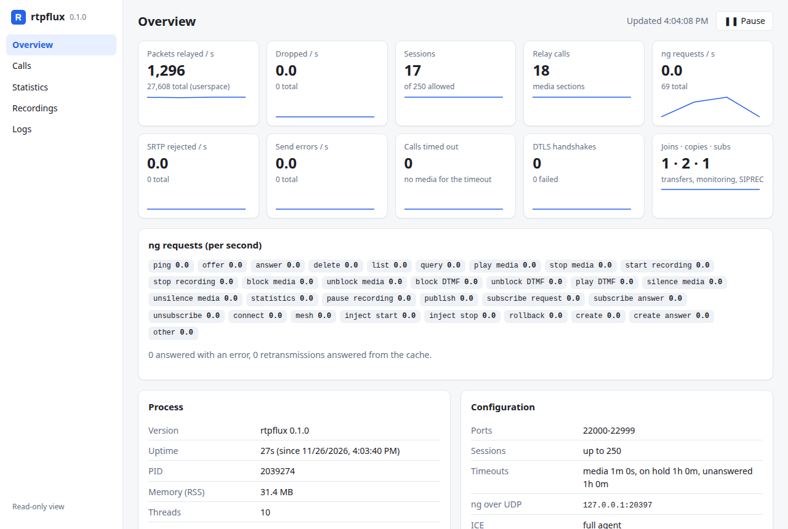

# Web UI

rtpflux can serve a small website for operators. It shows what the relay
is doing right now: traffic, calls, statistics and recent log lines. It is
**read-only**: nothing you do in it can change a call or the relay.



## Turning it on

1. Choose a password and make its hash. The command reads the password
   from standard input (`read -s` keeps it off the screen and out of the
   shell history):

   ```sh
   read -s -p "Password: " pw && echo "$pw" | rtpflux --webui-hash; unset pw
   ```

   It prints a line like `sha256:3f1c…:9a07…`.

2. Add a `[webui]` section to the configuration:

   ```toml
   [webui]
   listen = "127.0.0.1:8090"
   user = "admin"
   password_hash = "sha256:3f1c…:9a07…"
   ```

3. Restart rtpflux and open `http://127.0.0.1:8090/`. The browser asks
   for the user and password.

See [Configuration](configuration.md#webui-the-web-ui) for every option.

## Pages

| Page | What it shows |
|---|---|
| Overview | Live tiles with five-minute sparklines: packets relayed and dropped per second, sessions, relay calls, ng requests per second, SRTP rejections, send errors, calls ended by the media timeout, DTLS handshakes (and failures), joins, copies and subscriptions, and with XDP the packets relayed in the kernel and the calls there. ng requests per second by command. The process (version, uptime, memory, threads, workers, and how each worker receives: `io_uring`, or `recvmmsg` and why `io_uring` was refused, flagged when it is not as configured) and the configuration (ports, sessions and `strict_source`, every timeout, interfaces and their learned server-reflexive addresses, ICE mode and STUN server, ng over UDP, TCP and HTTP/WebSocket, metrics, state file and Redis, XDP, recording, and S3 with its webhook). Configuration warnings from start-up (what `--check` prints) are shown at the top. A **Media workers** table shows each worker's calls, calls in XDP, packets per second, totals relayed and dropped, send errors, SRTP rejections and how it receives, so an overloaded or idle worker stands out. |
| Calls | Every dialog: state (offered or answered), age, call-id, tags, interfaces, security (plain, SDES-SRTP or DTLS-SRTP), number of media sections, and whether it is recorded, blocked or playing an announcement. Badges show what links a call to more parties or to other calls: **multi-party** (more than one dialog: a B2BUA's legs, a three-way call, a conference), **joined** (`connect`: a transfer), **copies** (monitoring, whisper, `inject`, `mesh`) and **subscribed** (SIPREC and other subscriptions); search for them by name. Search, sort and pages. Click a call to see what will end it (an unanswered offer, `final_timeout`, a `delete-delay` under way, with the time left) and its fork branch, then each media section: profiles, security, `rtcp-mux`, BUNDLE, ICE passed through, and whether the XDP program relays it in the kernel; for each side the codec it receives, the conversion of what it sends, its ptime, the direction its SDP asks for (sendrecv, sendonly, recvonly, inactive, or held with `c=0.0.0.0`), latching (`strict-source`, handover), DTLS role and ICE, non-RTP media (T.38) and DTMF security; and for each side's RTP and RTCP legs the peer address, relay port, packets, octets, drops, loss, jitter, round-trip time, the DTMF keys received, whether the latch has settled, the DTLS state (handshaking or keyed) and the relay's ICE agent (role, state, selected pair, consent). A call with more than two parties, links or subscriptions also shows **Parties and links**: each party with its label, codec and the parties it is in dialogs with; each join or copy with its direction, the other call when it is in one, and the codec conversion; and each subscription with its sources, profile and state. |
| Statistics | Every counter and gauge (the same as `/metrics`), with its rate per second and a five-minute history; filter by group. |
| Recordings | With `[recording] dir`: the pcaps there (each recording's, while it is written and, with `keep_pcap`, after it is converted), with call-id, tags, length, size and whether an audio file was made. Click one to see its **streams** (per sender, receiver and SSRC: packets, octets, packets lost, length, payload types; caller and callee once converted) and its **packets** (time, addresses, kind — RTP, RTCP, STUN, DTLS, ZRTP —, length, and the RTP or RTCP header fields; filter by kind, search, sort), or download the pcap for Wireshark. Payloads are never shown. With `storage = "s3"` it has two more tabs, since uploaded files leave the directory: **Uploads to S3** (the bucket, endpoint, prefix and webhook settings, then the last 200 uploads: when, call, each file's object key, size, and why a file was kept locally) and **Webhook deliveries** (the last 200 notifications: outcome — delivered, rejected, failed or dropped —, HTTP status, attempts, error and delivery id). Error texts never include URL queries or credentials. |
| XDP | With `[xdp] enabled`: the calls the XDP program relays in the kernel, with their dialog, media section and worker, and for each direction the peer, where it is sent, the device, packets and octets (as of the relay's last poll, once a second), and what the kernel does besides relaying (drops a blocked side, sends DTMF up to userspace, copies to the recording ring). |
| Logs | A live tail of the last log lines (`log_buffer`), with a level filter and search. Only lines that pass the log level are kept. A call's **Log lines of this call** button opens it searching for the call-id. |

The views refresh every `refresh_ms` (two seconds by default) while they
are open. The **Pause** button in the header stops all refreshing. Light
and dark mode follow the system, and the layout works on a phone.

Packets the XDP fast path relays in the kernel are added to a call's
counters once a second.

## Security

- **Read-only.** The server answers `GET` and `HEAD` only; anything else
  gets `405`. Each API path reads one fixed piece of state.
- **Login on every request,** with HTTP Basic authentication. The password
  is stored only as a salted PBKDF2-HMAC-SHA256 hash (100,000 rounds, so
  slow to guess should the configuration leak), and compared in constant
  time. Hashes made by older versions (`sha256:…`) still work; make a new
  one with `--webui-hash` to get the stronger form.
- **Lockout.** Five failed logins from one address (for IPv6, one /64
  network) within a minute lock it out for a minute (`429`). Behind a
  reverse proxy every client has the proxy's address, so anyone's failed
  logins lock out everyone: there, let the proxy authenticate too, or rate
  limit at the proxy.
- **Slow clients.** A request head must arrive within 10 seconds of its
  first byte, so slow-sending clients cannot hold the connections.
- **No encryption of its own.** Basic authentication sends the password
  with every request. Keep `listen` on `127.0.0.1` and use an SSH tunnel
  (`ssh -L 8090:127.0.0.1:8090 relay-host`), or put a TLS reverse proxy
  such as nginx or Caddy in front of it.
- **Strict headers:** a Content-Security-Policy that allows only the UI's
  own files, `X-Frame-Options: DENY`, `nosniff` and `no-referrer`. API
  answers are never cached.
- **Limits:** request heads up to 8 KiB, no request bodies, idle
  connections closed after 15 seconds, at most `max_connections` at once.
- **What it shows:** call-ids, tags, and the IP addresses and ports of
  the parties. With `[recording] dir`, it also hands out the recordings'
  pcaps, which hold the calls' audio (recorded after SRTP decryption).
  It never shows SRTP keys or DTLS secrets. Treat access to the UI as
  access to that data and to the recordings.
- **Recordings, safely:** a recording is named by its path in the
  recording directory, which must end in `.pcap` and name a regular file
  in it or in a `recording-path` subdirectory: plain names, none starting
  with `.` (so no `..`), at most 4 levels, never through a link. At most 300,000 packets of a file are
  read per request (a longer one says so), and pcaps over 256 MiB are not
  downloaded through the UI.

## The API

The UI's JSON API can be used on its own, for example with `curl`:

```sh
curl -u admin 'http://127.0.0.1:8090/api/v1/calls?q=alice&sort=-age'
```

| Path | Answer |
|---|---|
| `/api/v1/meta` | Version, refresh interval and the available pages |
| `/api/v1/info` | Process and configuration facts |
| `/api/v1/stats` | Every counter and gauge, with kind, help and a timestamp |
| `/api/v1/calls` | The dialogs |
| `/api/v1/calls/detail?call_id=…&from_tag=…` | One dialog with its legs (`from_tag`: the row's `key`) |
| `/api/v1/calls/parties?call_id=…` | A call's parties, dialogs, links (joins and copies, to other calls too) and subscriptions |
| `/api/v1/logs?after=<seq>` | Log lines after a sequence number |
| `/api/v1/recordings` | The pcaps in `[recording] dir`, newest first |
| `/api/v1/recordings/streams?file=…` | One recording's streams, and the converter's JSON when there is one |
| `/api/v1/recordings/packets?file=…&kind=…` | Its packets (`kind`: `RTP`, `RTCP`, `STUN`, `DTLS`, `ZRTP`, `other`) |
| `/api/v1/recordings/download?file=…` | The pcap itself (`application/vnd.tcpdump.pcap`) |
| `/api/v1/xdp` | With `[xdp] enabled`: the calls in the kernel, each with both directions |
| `/api/v1/uploads` | With `storage = "s3"`: the last 200 uploads, newest first |
| `/api/v1/uploads/webhooks` | With a webhook: the last 200 upload notifications, newest first |

`calls`, `recordings`, `recordings/packets`, `uploads`, `uploads/webhooks` and `xdp` accept `q` (search), `sort`
(`field`, or `-field` for descending), `offset` and `limit` (up to 500),
and answer
`{total, offset, limit, rows}`. The list is cached for a second, so many
open browsers cost the relay one answer per second.

## Changing the UI

The app is written in TypeScript with [Preact](https://preactjs.com/),
in `crates/rtpflux/webui/ui/`. The built files (`webui/assets/`, about
16 KB gzipped) are committed and embedded in the binary, so building
rtpflux needs no Node.js. After changing the sources, rebuild them with
Node.js 22 or later:

```sh
cd crates/rtpflux/webui/ui
npm ci
npm run check      # type-check, then build into ../assets
cargo build --release
```

The build is reproducible: the same sources give the same files.

The UI started as a copy of the web UI of
[ferrosip](https://github.com/RustedBytes/ferrosip), adapted to rtpflux.
